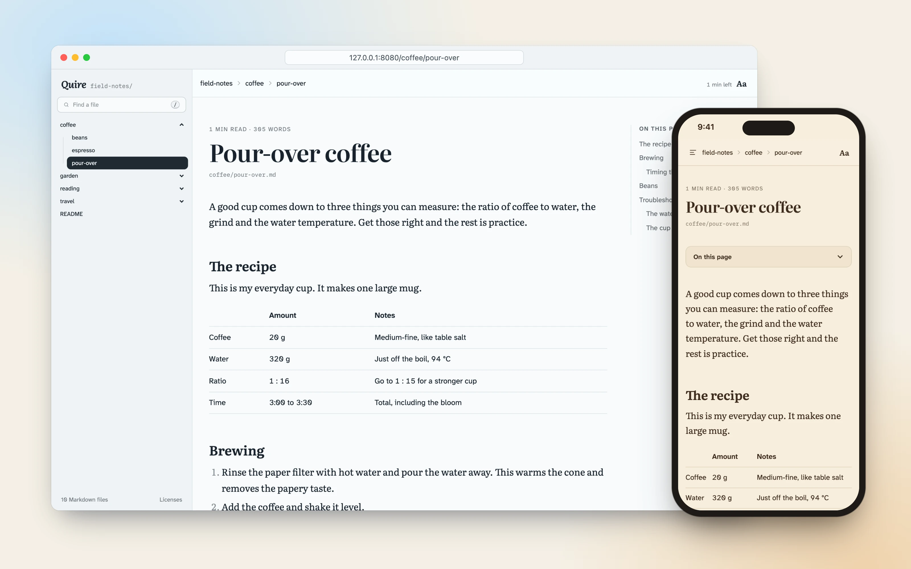
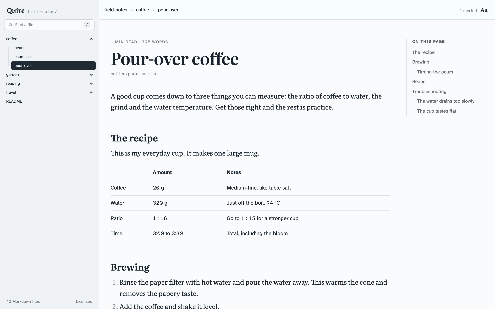

# Quire

Quire is a reader for folders of Markdown files. Point it at a folder and it serves the files as a website you can browse and read on your own machine. It ships as a single binary with nothing else to install.

I built it to read my notes and project docs with proper typography, without setting up a static site generator.



## What it does

<picture>
  <source media="(prefers-color-scheme: dark)" srcset="docs/screenshot-dark.webp">
  
</picture>

- Lists every Markdown file in the folder in a sidebar. It skips hidden folders such as `.git` and dependency folders such as `node_modules`.
- Opens `README.md` or `index.md` when you visit a folder.
- Shows a table of contents, reading time and links to the previous and next files.
- Marks links to files that don't exist.
- Has four themes (auto, paper, sepia and ink) and three fonts. Your choices are saved in the browser.
- Works offline. The fonts and scripts are built into the binary.

Keyboard shortcuts:

| Key | Action |
|---|---|
| `/` | Find a file |
| `[` | Show or hide the sidebar |
| `+` and `-` | Change the text size |
| `t` | Switch theme |
| `Esc` | Close menus |

## Run it

You need [Go](https://go.dev) 1.27 or later. You don't need Node.js.

Install it with `go install`. This puts a `quire` binary in `$(go env GOPATH)/bin`, so make sure that folder is on your `PATH`.

```sh
go install github.com/jianyuan/quire/cmd/quire@latest

quire                          # read this folder on http://127.0.0.1:8080
quire ~/notes                  # read another folder
quire -addr :3000 ~/notes      # listen on port 3000 on every network interface
```

To try it without installing, use `go run`. Go downloads and builds it each time, but caches the result.

```sh
go run github.com/jianyuan/quire/cmd/quire@latest ~/notes
```

From a clone of this repository:

```sh
go run ./cmd/quire ~/notes
```

Prebuilt binaries for macOS, Linux and Windows are on the [releases page](https://github.com/jianyuan/quire/releases).

Quire only reads files inside the folder you give it. It listens on `127.0.0.1` by default, so other machines can't reach it. Use `-addr` with care, because anyone who can reach the port can read the files in the folder.

## Build it

`make` on its own lists every target. The main ones:

```sh
make build    # build bin/quire for this machine
make run      # build, then serve DIR on ADDR (make run DIR=~/notes)
make dist     # build release archives for every platform into dist/
```

The binaries are about 7 MB each and have no other dependencies.

Releases are built with [GoReleaser](https://goreleaser.com), using the settings in `.goreleaser.yaml`. `make dist` runs it locally through `go run`, so you don't need to install it. It builds for macOS, Linux and Windows on amd64 and arm64.

To publish a release, push a tag such as `v0.1.0`. GitHub Actions runs GoReleaser, which attaches the archives and a `SHA256SUMS` file to a GitHub release.

## Change the web app

The reader's page is a [Vite](https://vite.dev) app in `web/`, styled with Tailwind CSS and daisyUI. The Go server embeds the built files from `web/dist`. That folder is committed, so `go install` and `go run` work without Node.js.

To work on the page you need Node.js and [pnpm](https://pnpm.io):

```sh
make install    # install the web app's packages
make dev        # run Vite and the Go server together, with live reload
make web        # rebuild web/dist
```

After changing anything in `web/`, run `make web` and commit `web/dist` with your change. `make check-web` fails if `web/dist` is out of date, so it can run in CI.

## Licences

Quire bundles fonts and libraries under the MIT, Apache 2.0 and SIL Open Font licences. The binary serves the full text of each at `/licenses`, and there's a link at the bottom of the sidebar. The Go licence is in [`THIRD_PARTY_NOTICES.md`](THIRD_PARTY_NOTICES.md).

Quire itself is under the [MIT licence](LICENSE).
